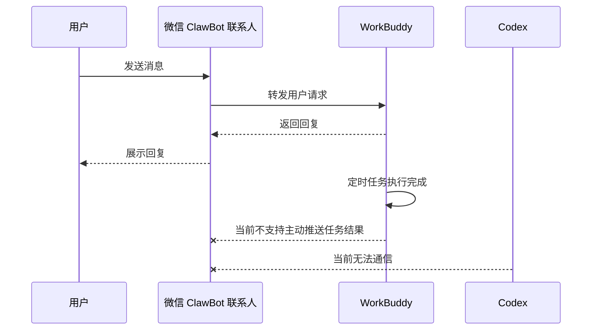
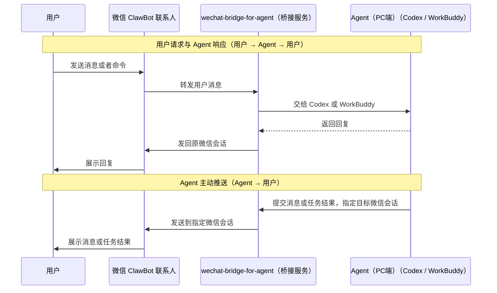
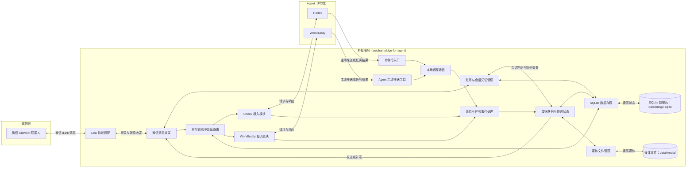
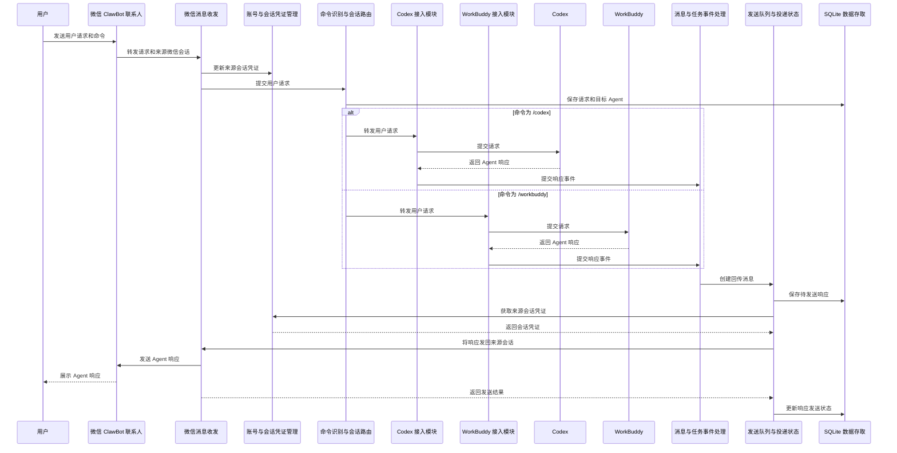
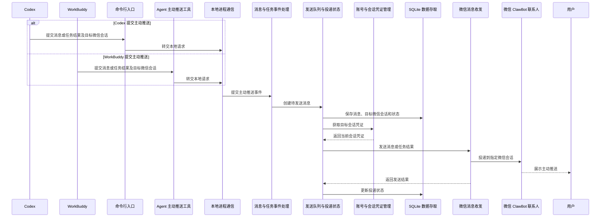
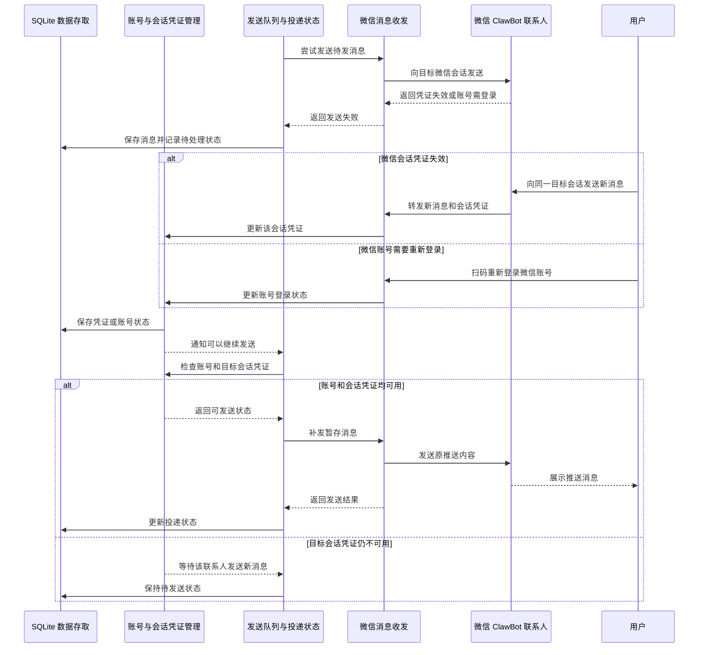

# wechat-bridge-for-agent

一个轻量的 TypeScript 常驻服务，让微信与 Codex、WorkBuddy 双向通信，并将定时任务结果发回指定微信会话。

## 1. 需求

### 1.1 当前现状（未接入桥接服务）

微信 ClawBot 可将用户消息转发给 WorkBuddy，并接收其回复。但目前它无法接收 WorkBuddy 的主动推送（比如定时任务结果），也无法与 Codex 通信。

### 1.2 需求目标（接入 wechat-bridge-for-agent）

接入后，用户可通过 ClawBot 向目标 Agent（Codex 或 WorkBuddy）发送请求并收到响应。Agent 也可将定时任务结果主动推送到指定的 ClawBot 会话。

1. 用户可通过 `/codex` 或 `/workbuddy` 命令选择目标 Agent（Codex 或 WorkBuddy）。桥接服务将用户请求转发给对应的 Agent。
2. 一个微信会话可以产生多条用户请求。桥接服务需记录每条请求的来源会话，收到 Agent 响应后将其发回该会话，并记录请求转交和响应发送状态。
3. Agent 可主动推送消息和定时任务结果。主动推送时需要指定目标微信会话。
4. 如果消息暂时发不出去，桥接服务会先保存。联系人再次发来消息或账号重新登录后，桥接服务确认可以发送时再补发并记录结果。
5. 桥接服务负责接收、转发和发送消息。Agent 负责处理用户请求和执行定时任务。

### 1.3 名词解释

- **微信账号：** 桥接服务连接并用于收发消息的微信账号。一个微信账号下可以有多个联系人和微信会话。
- **微信联系人：** 从桥接服务连接的微信账号一侧看，与 ClawBot 对话的用户。联系人标识需要结合所属微信账号确定。
- **微信会话：** 桥接服务连接的微信账号与某个微信联系人之间的聊天。用户在手机上看到的是与“微信 ClawBot”联系人的聊天。一个会话可以包含多条用户请求。
- **目标微信会话：** 消息要发送到的微信聊天，由微信账号和该账号下的联系人共同确定。用户请求的 Agent 响应返回来源会话，主动推送和任务结果发送到 Agent 指定的目标会话。
- **微信 ClawBot：** 用户微信中显示的 AI 联系人。用户通过与它聊天向桥接服务提交请求并接收 Agent 响应。
- **用户：** 使用微信 ClawBot 发送请求和接收响应的人。在桥接服务侧，用户对应一个微信联系人。
- **用户请求：** 用户通过 ClawBot 发给 Agent 的消息。每条用户请求都关联其来源微信会话。
- **命令：** 用户在 ClawBot 中输入的操作指令，例如用 `/codex` 或 `/workbuddy` 选择 Agent。
- **Agent（PC端）：** 处理用户请求的 Codex 或 WorkBuddy。
- **Agent 响应：** Agent 处理用户请求后返回的回复。桥接服务根据请求与微信会话的关联，将响应发回该请求的来源会话。
- **定时任务：** Agent 按预设时间自动执行的任务。
- **任务结果：** 定时任务完成后产生的内容和执行情况。
- **主动推送：** Agent 无需等待当前用户请求，主动向指定微信会话发送消息。
- **桥接服务：** `wechat-bridge-for-agent`，负责在 ClawBot 和 Agent 之间传递消息，并把响应或通知送到对应的微信会话。

## 2. 技术方案

### 2.1 系统架构

桥接服务中的每个方框对应一个代码模块，圆柱体表示由桥接服务管理的本地存储。用户请求经微信收发和会话路由模块交给选定的 Agent。Agent 响应与主动推送都经事件处理和发送队列发回微信。

| 图中模块名称 | 代码模块路径 | 主要职责 |
| --- | --- | --- |
| iLink 协议适配 | `src/wechat/ilink/` | 封装 iLink 登录、消息轮询、发送和错误处理。 |
| 微信消息收发 | `src/wechat/client.ts` | 调用 iLink 协议适配模块收发消息，并将用户消息交给会话路由模块。 |
| 账号与会话凭证管理 | `src/wechat/accounts.ts` | 管理微信账号状态、同步游标和会话凭证。 |
| 命令识别与会话路由 | `src/core/router.ts` | 解析命令，选择 Agent，并维护请求与微信会话的对应关系。 |
| Codex 接入模块 | `src/adapters/codex.ts` | 连接 Codex，提交请求并接收响应和事件。 |
| WorkBuddy 接入模块 | `src/adapters/workbuddy.ts` | 连接 WorkBuddy，提交请求并接收响应。 |
| Agent 主动推送工具 | `src/notify/mcp.ts` | 提供 Agent 提交主动消息和任务结果的 MCP 工具。 |
| 命令行入口 | `src/cli.ts` | 提供服务管理命令及主动消息、任务结果提交入口。 |
| 本地进程通信 | `src/notify/ipc.ts` | 将 MCP 和命令行请求传给常驻服务。 |
| 消息与任务事件处理 | `src/core/events.ts` | 统一处理 Agent 响应、主动消息和任务结果事件。 |
| 发送队列与投递状态 | `src/core/outbox.ts` | 保存待发消息、执行发送并记录投递状态。 |
| SQLite 数据存取 | `src/storage/sqlite.ts` | 管理数据库结构、事务和迁移。数据库文件建议存放于 `data/bridge.sqlite`。 |
| 媒体文件管理 | `src/storage/media.ts` | 保存和清理待发送的媒体文件。文件建议存放于 `data/media/`。 |

`src/daemon.ts` 负责启动和管理上述模块。该模块不直接参与消息流转，因此未单独画入图中。

### 2.2 运行时序

#### 场景一：用户请求与 Agent 响应

#### 场景二：Agent 主动推送消息或任务结果

#### 场景三：主动推送失败后的恢复补发

### 2.3 数据结构设计

微信会话由微信账号和该账号下的微信联系人共同确定，使用 `(wechat_account_id, contact_id)` 标识。每条用户请求关联来源微信会话，Agent 响应通过请求 ID 找回该会话。主动推送在提交时明确指定目标微信会话。

| 数据表 | 关键字段 | 用途 |
| --- | --- | --- |
| `wechat_accounts` | `wechat_account_id`、`bot_token`、`base_url`、`get_updates_buf`、`login_status` | 保存 iLink 登录信息、消息同步游标和账号状态。 |
| `wechat_sessions` | `wechat_account_id`、`contact_id`、`context_token`、`context_updated_at`、`selected_agent` | 保存微信会话、当前目标 Agent 和该会话最近的发送凭证。账号与联系人组成主键。 |
| `agent_bindings` | `wechat_account_id`、`contact_id`、`agent_type`、`agent_conversation_id`、`reply_cursor` | 保存微信会话与 Codex 或 WorkBuddy 会话的关联及回复读取位置。 |
| `agent_credentials` | `agent_type`、`account_key`、`access_token`、`refresh_token`、`expires_at` | 保存 WorkBuddy 授权凭据及更新状态。Codex 沿用本机已有登录状态。 |
| `user_requests` | `request_id`、`wechat_account_id`、`contact_id`、`wechat_message_key`、`agent_type`、`agent_request_id`、`content`、`status` | 记录用户请求的来源会话、转发目标和处理状态。 |
| `agent_events` | `event_id`、`agent_type`、`event_key`、`event_type`、`request_id`、`run_id`、`target_account_id`、`target_contact_id`、`payload` | 记录 Agent 响应、主动消息和任务结果。响应关联用户请求，主动推送记录目标微信会话。 |
| `outbox_messages` | `outbox_id`、`event_id`、`target_account_id`、`target_contact_id`、`content`、`status`、`attempt_count`、`next_attempt_at`、`last_error`、`client_message_id` | 保存每条待发消息、目标微信会话及发送结果。 |
| `media_files` | `media_id`、`outbox_id`、`local_path`、`mime_type`、`size_bytes`、`checksum` | 保存待发媒体的本地文件信息，文件放在 `data/media/`。 |

微信入站消息按微信账号和消息标识去重。Agent 主动推送提交时提供稳定的事件标识，任务结果可使用任务运行 ID。Agent 事件按来源、事件标识和目标微信会话去重。接收消息时，先在同一数据库事务中保存请求、会话凭证和同步游标，再转发给 Agent。发送 Agent 响应或主动推送前，先在同一事务中保存事件和待发消息。

用户请求依次记录“已接收”“已转发”和“已响应”，处理失败时记录原因。响应的发送状态由待发消息单独记录。

待发消息的状态包括“待发送”“发送中”“微信已受理”“等待会话凭证”“需要重新登录”“等待重试”和“结果待核实”。会话凭证失效时等待同一微信会话的新消息，账号登录失效时等待重新登录。发送结果不确定时保留内容并核实，避免盲目重试造成重复消息。待发内容不按时间或队列长度自动丢弃。“微信已受理”只表示 iLink 接口接受发送请求，不代表用户已经阅读。

登录凭据、会话凭证和 WorkBuddy 授权凭据仅保存在本机受限目录中。WorkBuddy 开发者应用凭据由本机受限配置提供，日志不记录任何凭据原文。

### 2.4 技术选型

| 组件 | 选型 | 用途与选择依据 |
| --- | --- | --- |
| 运行环境 | [Node.js 24 LTS](https://nodejs.org/en/about/previous-releases) + TypeScript | 运行本机常驻服务，使用同一语言实现微信、Agent 和存储模块。 |
| 微信接入 | 自建 TypeScript iLink 适配模块 | 依据[腾讯微信插件的协议实现](https://github.com/Tencent/openclaw-weixin/blob/main/docs/protocol_zh_CN.md)实现登录、长轮询和消息收发，参考 [CLI-WeChat-Bridge](https://github.com/UNLINEARITY/CLI-WeChat-Bridge) 的错误分类与顺序发送设计。 |
| Codex 接入 | [Codex app-server](https://developers.openai.com/blog/codex-as-a-platform) 的本机 JSON-RPC 接口 | 管理 Codex 会话、请求、响应和运行事件。初版由桥接服务启动并通过标准输入输出通信。 |
| WorkBuddy 接入 | [WorkBuddy Open API](https://open.workbuddy.cn/docs/openapi) + OAuth 2.1 | 注册开发者应用并取得用户授权后，向 PC 端本地助理发送文字，按消息标识查询回复。并发回复的归属需要在接入时验证。 |
| Agent 主动推送 | [MCP TypeScript 服务端 SDK](https://github.com/modelcontextprotocol/typescript-sdk/blob/main/docs/serving/stdio.md) + 本地 CLI | WorkBuddy 通过[本地 MCP 连接器](https://open.workbuddy.cn/docs/connector)提交消息或任务结果，Codex 和本机任务通过 CLI 提交，入口统一写入事件与发送队列。 |
| 本地进程通信 | Node.js `node:net` 本机套接字或命名管道 | 将 MCP 工具与 CLI 的提交请求传给常驻服务，仅允许本机进程访问。 |
| 持久化 | SQLite + [better-sqlite3](https://github.com/WiseLibs/better-sqlite3) | 使用事务保存会话关联、处理状态和待发消息，启用 WAL 模式，数据库位于 `data/bridge.sqlite`。 |
| 媒体存储 | 本地目录 + Node.js 内置文件与加密模块 | 待发媒体保存至 `data/media/`，通过 iLink 媒体接口发送，按类型逐项验证。 |
| 验证 | Node.js `node:test` + 模拟接口 + 真实账号联调 | 验证路由归属、消息去重、重启恢复、凭证失效和实际微信投递。 |

每个微信账号只启动一个消息轮询实例。出站消息由发送队列按目标微信会话顺序发送，网络错误退避重试，账号或会话凭证失效时暂停相应消息的发送。腾讯的协议文档依据当前客户端代码编写，服务端行为仍需用真实微信账号验证。

## 3. 实现计划

分两个阶段交付。Stage One 先完成微信与 WorkBuddy 的文字通信和 WorkBuddy 主动推送。Stage Two 接入 Codex，并复用已完成的微信接入、会话管理和发送队列。

### 3.1 Stage One：WorkBuddy 接入

1. 验证接入条件。确认 iLink 扫码后桥接服务能在预期的微信 ClawBot 会话收发消息，明确与现有 WorkBuddy 连接的切换方式。完成 WorkBuddy 开发者应用准备，验证授权、发送消息和查询回复接口。
2. 建立桥接服务基础。实现常驻进程、SQLite 数据表和本地进程通信。数据表从一开始使用微信账号与联系人共同标识微信会话，支持后续增加微信账号和 Agent。
3. 完成微信接入。实现 iLink 扫码登录、长轮询、文字收发、入站去重、账号状态和会话凭证保存。每个微信账号只启动一个轮询实例，发送请求由队列顺序执行。
4. 接入 WorkBuddy。完成用户授权，调用 WorkBuddy Open API 向 PC 端本地助理发送文字并查询回复。实现 `/workbuddy` 命令，将每条请求和回复关联到来源微信会话。先验证并发回复能否准确归属，不能准确区分时对同一授权用户的请求串行处理。
5. 实现 WorkBuddy 主动推送。提供本地 MCP 工具，由 WorkBuddy 提交消息或任务结果、稳定事件标识和目标微信会话。配置一条实际的 WorkBuddy 定时任务，验证任务结束后能自动调用该工具提交结果。桥接服务先保存事件与待发消息，再尝试发送。
6. 完成失败恢复。会话凭证失效时保留消息，等待同一微信会话的新消息后补发。账号登录失效时等待重新登录，网络异常时退避重试，发送结果不确定时保留待核实状态。服务重启后继续处理未完成消息。

Stage One 的验收标准是用户通过微信 ClawBot 向 WorkBuddy 发送文字并在原会话收到回复。一条实际的 WorkBuddy 定时任务结束后，无需用户再次发起请求或人工提交，任务结果能自动进入桥接服务，并在会话凭证有效时推送到指定微信会话，在微信客户端看到。凭证失效时结果保持待发，待同一微信会话收到新消息后补发。账号重新登录和服务重启后也能继续处理待发消息。若定时任务无法自动调用 MCP 工具，需建立其他自动上报路径后才能通过此项验收。

### 3.2 Stage Two：Codex 接入与能力补齐

1. 接入 Codex app-server。通过本机 JSON-RPC 提交请求、接收回复和运行事件，并为每个微信会话保存对应的 Codex 会话标识。
2. 完成双 Agent 路由。支持 `/codex` 和 `/workbuddy` 选择目标 Agent，保存每个微信会话的选择结果。Agent 响应按请求关联发回来源会话，两个 Agent 的会话和回复互不混淆。
3. 接入 Codex 主动推送。提供本地 CLI 入口，让 Codex 任务提交消息或任务结果、稳定事件标识和目标微信会话。Codex 与 WorkBuddy 共用 Stage One 的事件处理、去重和发送队列。
4. 补齐多账号和媒体能力。为每个微信账号独立管理登录状态、轮询游标、会话凭证和待发消息。媒体按图片、文件、语音和视频逐项实现，并在实际微信客户端验证后启用。

Stage Two 的验收标准是用户可在同一微信会话切换 Codex 与 WorkBuddy，两个 Agent 的回复都准确返回原会话。Codex 能主动推送任务结果。多个微信账号和联系人同时使用时不会串消息，媒体类型以实际验证通过的范围为准。
